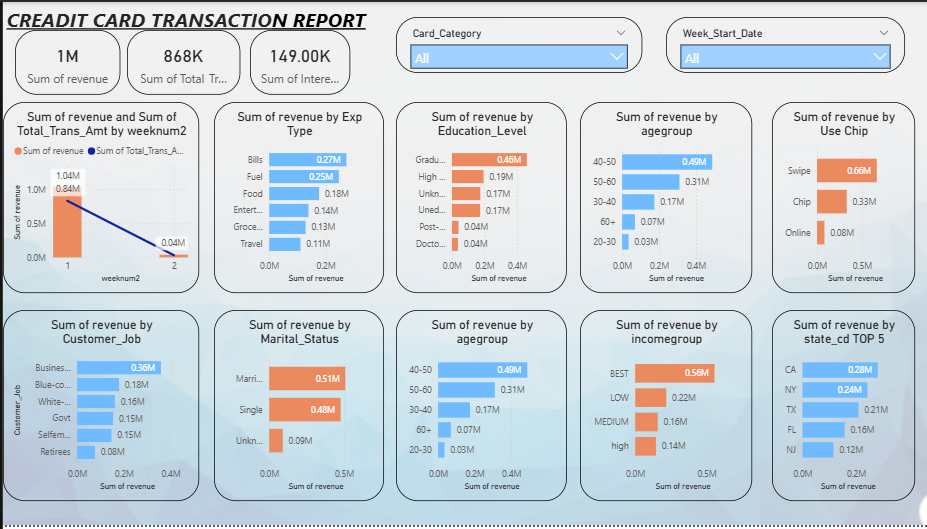
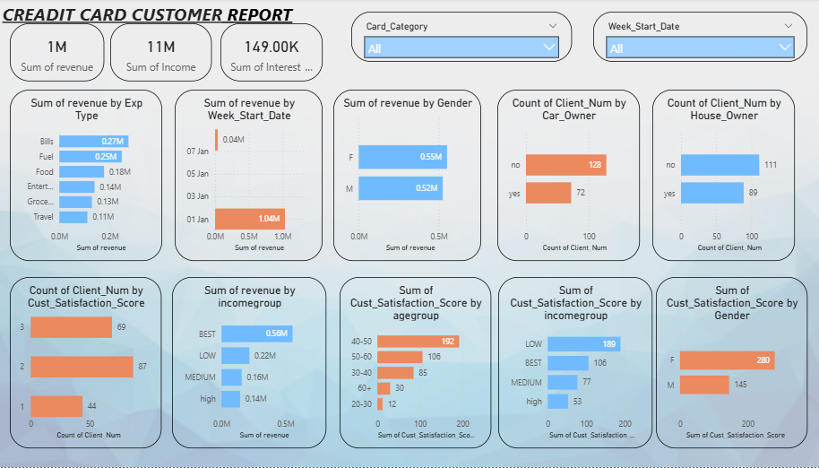

# 💳 Credit Card Transaction & Customer Dashboard | Power BI

> An interactive 2-page Power BI dashboard analyzing credit card data to uncover spending behaviors, customer demographics, and revenue drivers. Processing over **$1M in Revenue** and **$868K in Transaction Amounts**.


---

## 📌 Project Overview

This project provides a comprehensive view of a credit card portfolio by analyzing two distinct perspectives: **Transaction Analysis** and **Customer Demographics**. 

The goal was to build a dual-page interactive dashboard that allows stakeholders to track key performance indicators (KPIs), identify high-value customer segments, and understand which expenditure categories drive the most revenue and interest.

---

## 📊 Key Metrics (KPIs)

- **Total Revenue:** $1M
- **Total Transaction Amount:** $868K
- **Total Interest Earned:** $149K

---

## 💡 Key Business Insights (The "So What?")

### 💰 Transaction Insights (Page 1)
- **Top Expenditure Categories**: **Bills** ($0.27M) and **Fuel** ($0.25M) are the highest revenue-generating spending categories, followed by Food and Entertainment.
- **Customer Demographics**: **Graduates** generate the most revenue ($0.46M) by education, and the **40-50 age group** is the most lucrative segment ($0.49M).
- **Occupation & Marital Status**: **Businessmen** ($0.36M) are the highest-spending professionals, and **Married** customers ($0.51M) outspend Single customers.
- **Technology Usage**: **Swipe** transactions dominate heavily ($0.66M) compared to Chip and Online transactions.

### 👥 Customer Insights (Page 2)
- **Gender Breakdown**: **Female** customers generate slightly higher revenue ($0.55M) compared to Male customers ($0.52M).
- **Asset Ownership**: The majority of credit card clients do **not** own a car or a house.
- **Satisfaction Score**: The highest number of clients (87) gave a satisfaction score of **2 out of 3**.
- **Time-Series Trend**: There was a massive spike in revenue on **January 1st** ($1.04M), likely due to holiday season spending or annual billing cycles.

---

## 🖼️ Dashboard Previews

**Page 1: Credit Card Transaction Report**
*Focuses on revenue breakdown by expenditure type, education, age, job, and chip usage.*


**Page 2: Credit Card Customer Report**
*Focuses on customer demographics, satisfaction scores, and asset ownership (car/house).*


---

## 🛠️ Tech Stack & Methodology

| **Category** | **Tools & Techniques** |
| :--- | :--- |
| **Data Visualization** | Power BI Desktop (Custom themes, Bar/Line charts, KPI Cards) |
| **Data Transformation** | Power Query (ETL - Cleansing, Merging customer and transaction tables) |
| **Calculations** | DAX (Measures for Revenue, Interest Earned, and Transaction Amounts) |
| **Data Modeling** | Star Schema (Connecting Fact tables with Customer and Date dimensions) |

**Methodology:**
1. **Data Cleaning**: Handled missing values and standardized data formats using Power Query.
2. **Data Modeling**: Built a relational model connecting the `ccdb_cc_add` (transactions) and `ccdb_cust_add` (customer demographics) tables.
3. **DAX Implementation**: Created dynamic measures for Revenue, Interest, and Client Counts.
4. **UI/UX Design**: Designed a light, clean, two-page layout with cross-filtering slicers (Card Category and Week Start Date) for seamless user experience.

---

## 📂 Repository Structure

```plaintext
CREADET_CARD_REPORT/
│
├── README.md
├── creditcard_report.pbix      ← Main Power BI file
├── ccdb_cc_add.csv             ← Transaction dataset
├── ccdb_cust_add.csv           ← Customer dataset
├── page1.png                   ← Transaction Dashboard Screenshot
└── page2.png                   ← Customer Dashboard Screenshot
